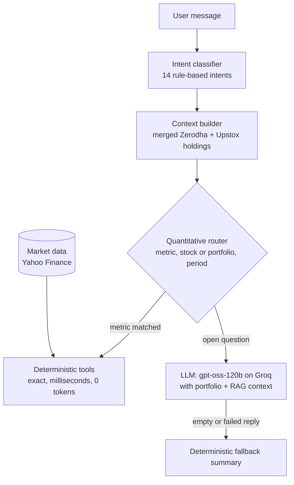

# Foleo

**An AI portfolio assistant for Indian investors that gets the numbers exactly right.**

Foleo links to your Zerodha or Upstox account and combines a live portfolio dashboard with a chat assistant. When you ask for a number (Sharpe ratio, Value at Risk, drawdown, RSI, P&L), Foleo computes it with tested code instead of letting a language model guess. The answer is exact, takes milliseconds and costs zero LLM tokens. Open-ended questions ("how is my portfolio doing?", "how should I rebalance?") go to the LLM, with your real portfolio as context.

**Live demo: [foleo-one.vercel.app](https://foleo-one.vercel.app)**

---

## Contents

- [Try it in two minutes](#try-it-in-two-minutes)
- [What to ask the assistant](#what-to-ask-the-assistant)
- [Everything else in the app](#everything-else-in-the-app)
- [How it works](#how-it-works)
- [Why deterministic tools: our results](#why-deterministic-tools-our-results)
- [Tech stack](#tech-stack)
- [Repository layout](#repository-layout)
- [Run it locally](#run-it-locally)
- [Tests](#tests)
- [Deployment](#deployment)
- [Team](#team)

---

## Try it in two minutes

1. **Open [foleo-one.vercel.app](https://foleo-one.vercel.app)** and click **GET STARTED**.
2. **Create an account.** Choose the **Register** tab, enter any email and a password (6+ characters) and click **CREATE ACCOUNT**. You will see *"Account created successfully. Please sign in."* and the form switches to **Sign In** with your email filled in.
3. **Sign in.** Enter your password and click **SIGN IN**. You land on the **Portfolio** dashboard.
4. **Load a portfolio.** No broker account needed:
   - Click **Try a demo portfolio**. Foleo loads six NSE stocks (TCS, HDFCBANK, RELIANCE, INFY, ITC, SUNPHARMA), priced at the latest market close, and every page and the assistant work on it.
   - If you have a Zerodha or Upstox account, use **Broker → Link** instead to see your own holdings. Broker linking goes through the brokers' OAuth apps registered to our team, so for review purposes the demo portfolio is the reliable path.
5. **Open the Assistant** (left sidebar) and try the prompts below.

> **Good to know**
> - The login messages are explicit: signing in without an account says *"Account does not exist. Please register first."*, and registering an existing email says *"An account with this email already exists. Please sign in."*
> - The backend is kept awake around the clock. If a page ever takes longer than usual, it is waking up; give it up to a minute.
> - This is a demo deployment: accounts are stored in a lightweight SQLite database and are reset whenever a new version is deployed. If your login stops working, simply register again.

---

## What to ask the assistant

Foleo's assistant has two paths. Questions that ask for a **metric** are routed to deterministic tools; everything else goes to the LLM.

### 1. Exact numbers (deterministic tools, 0 LLM tokens)

If you don't name a stock, the metric is computed for **your whole portfolio**. You can add a period such as *"over the last 3 months"*, *"past year"* or *"over 2 years"*. Each answer states the stocks and the price window it used.

| Ask | What you get |
|---|---|
| `Calculate invested value, current value, profit or loss, and percentage profit or loss for each holding. Classify the portfolio as Buy, Hold, Trim, or Exit using only the supplied arithmetic.` | Invested value, current value, P&L, P&L % and a Buy / Hold / Trim / Exit decision from a fixed rule. **This is the project's main benchmark prompt.** |
| `What is the Sharpe ratio of my portfolio over the last 3 months?` | Risk-adjusted return (5% risk-free rate, sample std, √252) |
| `What is the 95% value at risk of my portfolio over the last 3 months?` | 1-day historical VaR at 95% |
| `What is the maximum drawdown of my portfolio over the last 3 months?` | Worst peak-to-trough fall |
| `What is the volatility of my portfolio?` | Annualised volatility |
| `What is the total return of my portfolio over the past year?` | Total return over the window |
| `What is the beta of my portfolio?` | Beta versus NIFTY 50 |
| `What is the Sortino ratio of my portfolio?` | Downside-risk-adjusted return |
| `What is the CAGR of my portfolio over 2 years?` | Compound annual growth rate |
| `What is the momentum of my portfolio?` | 21-day momentum |
| `What is the RSI of TCS?` | 14-day RSI for one stock |
| `What is the 50-day moving average of RELIANCE?` | 50- or 200-day moving average |
| `What is the beta of INFY?` | Stock beta versus NIFTY 50 |
| `What is the correlation between TCS and INFY?` | Correlation of daily returns |
| `What is the volatility of HDFCBANK over 6 months?` | Any metric, any stock, any window |
| `How concentrated is my portfolio?` | Largest holding weight |

The router understands plain English: *"my portfolio"* means all your holdings, broker symbols are mapped to the right exchange (`IDEA` → `IDEA.NS`, not the unrelated US ticker), and ordinary words like *"portfolio"* or *"maximum"* are never mistaken for tickers.

### 2. Advice and explanations (LLM with your portfolio as context)

| Ask | What you get |
|---|---|
| `How is my portfolio doing?` | Overall verdict, health score, biggest risk and one concrete action |
| `Which holding is dragging me down?` | The weakest position and what to do about it |
| `Give me a rebalancing plan` | Trim/add amounts based on weights and momentum |
| `What is the tax impact if I sell now?` | Unrealised gains/losses with current STCG/LTCG rules (Budget 2024) |
| `Add WIPRO to my watchlist` | Manages your watchlist from chat |
| `Set a goal: ₹10 lakh in 5 years` | Saves the goal, works out the monthly SIP and tracks progress in later chats |

Use the **Quick / Explain** switch at the top of the chat: *Quick* gives short answers; *Explain* walks through the reasoning. The chips under each answer suggest sensible follow-up questions.

---

## Everything else in the app

| Page | What it does |
|---|---|
| **Portfolio** | Holdings, invested value, P&L, a 6-factor health score (diversification, performance, risk, concentration, sector spread, beta fit), sector allocation with concentration alerts, performance vs NIFTY 50, India VIX gauge, market overview, and a shareable PNG report card |
| **Optimize** | Mean-variance optimisation of your actual holdings (Min Risk, Max Sharpe or Black-Litterman), with concrete BUY/SELL orders, efficient frontier, 12-month Monte Carlo with VaR/CVaR and a capital-gains tax estimate |
| **Assistant** | The chat described above |
| **News** | Latest headlines for your top holdings |
| **Baskets** | Curated themes (EV, Banking, IT Services and more), highlighting what you already hold |
| **Alerts** | Price alerts checked every 15 minutes, with in-app notifications |
| **Broker** | Link or unlink Zerodha and Upstox; holdings from both are merged |

---

## How it works



- **Portfolio scope.** For a portfolio question Foleo builds the daily value series `V_t = Σ qᵢ · Pᵢ,ₜ` of your current holdings and computes the metric on it, so stock-level and portfolio-level answers share one tested implementation.
- **Fixed definitions.** Each metric has one documented formula (e.g. VaR = −100 × 5th percentile of daily returns with linear interpolation; RSI-14 with simple averages), checked against an independent pandas reference in the test suite.
- **Safety rails.** A reply that comes back empty (reasoning models can spend their whole budget thinking) is replaced by a deterministic summary, so users never see a blank answer. The Buy/Hold/Trim/Exit rule is a fixed, transparent rule and not investment advice.

---

## Why deterministic tools: our results

We benchmarked 26 portfolio questions (arithmetic, stock metrics and portfolio risk metrics) against an independent pandas reference, on a pinned 3-month NSE price snapshot. The Groq LLM arms ran 3 times per prompt.

| Task tier | Foleo tools | Groq LLM given all the data | Groq chatbot without price history |
|---|---|---|---|
| Portfolio arithmetic | **10/10** | 30/30 | 29/30 |
| Stock metrics (return, drawdown, VaR, RSI) | **12/12** | 21/36 | 0/36 |
| Portfolio risk (Sharpe, VaR, drawdown, return) | **4/4** | 3/12 | 0/12 |
| LLM tokens per answer | **0** | 1,421 – 4,867 | ≈ 2,300 – 2,700 |
| Median time per answer | **0.1 – 3.3 ms** | 2.5 – 9.7 s | 1.2 – 1.9 s |

What we learned:

- **Arithmetic is not the weak point; time series are.** Given a 67-day price table, the LLM often ran out of its token budget before finishing (none of its 9 VaR answers completed) and once returned a wrong RSI with convincing working.
- **Without price data the LLM usually declines, but not always.** In 1 of 48 cases it answered the 3-month return with the gain since purchase (−6.74% instead of −19.27%).
- **Code execution fixes arithmetic, not definitions.** ChatGPT and Claude, running their own code, matched most values, but ChatGPT used its own RSI formula (3 wrong values), and Claude chose *Hold* when no decision rule was given.
- **In a live run on a real Upstox account (22 Oct 2026)**, Foleo, ChatGPT and Claude agreed on all 8 values when ChatGPT and Claude were handed the holdings, 192 prices, every formula and the rule. Foleo needed only the question.

Details: [`foleo/reports/RESEARCH_HANDOUT.md`](foleo/reports/RESEARCH_HANDOUT.md), the paper in [`foleo/paper/`](foleo/paper/) and the raw runs in [`foleo/reports/benchmark_runs/`](foleo/reports/benchmark_runs/).

---

## Tech stack

| Layer | Technology |
|---|---|
| Frontend | React 19, Vite, Tailwind CSS 4, Framer Motion, Recharts (deployed on **Vercel**) |
| Backend | FastAPI, Uvicorn, APScheduler, SQLite (deployed on **Render**) |
| AI | Groq `openai/gpt-oss-120b` (OpenAI-compatible), ChromaDB RAG knowledge base, FinBERT news sentiment (Hugging Face) |
| Quant | pandas, NumPy, yfinance, PyPortfolioOpt (efficient frontier, Ledoit-Wolf shrinkage, Black-Litterman) |
| Brokers | Zerodha Kite Connect and Upstox OAuth |

---

## Repository layout

```
foleo/
├── backend_api/        FastAPI app: auth, brokers, portfolio, chat, optimizer, alerts
│   ├── routes/         HTTP endpoints (all under /api)
│   ├── services/       broker clients, chat service, optimizer, market data
│   ├── database/       SQLite token and user store
│   └── core/           settings, security, demo portfolio
├── llm_orchestrator/   the assistant
│   ├── utils/          quantitative tools + router, intent router, analytics
│   ├── agents/         LLM response agent (Groq/OpenAI)
│   ├── pipelines/      end-to-end chat pipeline
│   ├── context/        portfolio context builder
│   ├── rag/            finance knowledge base (ChromaDB)
│   └── prompts/        system prompt
├── frontend/           React + Vite web app (vercel.json proxies /api to the backend)
├── tests/              pytest suite: backend and chatbot
├── scripts/            research benchmark harness and paper tables
├── reports/            benchmark runs, research handout, presentation
├── paper/              IEEE-style research paper (LaTeX + PDF)
├── docs/               design notes
├── render.yaml         Render blueprint for the backend
└── .env.example        environment variable template
.github/workflows/      keep-backend-awake job
```

---

## Run it locally

You need Python 3.12+, Node.js 20+ and a free [Groq API key](https://console.groq.com).

**Backend**

```bash
cd foleo
python -m venv .venv
source .venv/bin/activate          # Windows: .venv\Scripts\activate
pip install -r backend_api/requirements.txt
cp .env.example .env               # then set GROQ_API_KEY
uvicorn backend_api.app:app --reload --port 8000
```

**Frontend** (in a second terminal)

```bash
cd foleo/frontend
npm install
npm run dev                        # http://localhost:5174, proxies /api to port 8000
```

Open http://localhost:5174, register, sign in and click **Try a demo portfolio**.

---

## Tests

```bash
cd foleo
python -m pytest tests -q
```

The suite (82 tests) covers the quantitative tools against an independent reference, the router (portfolio scope, exchange mapping, word boundaries), the benchmark scorer, portfolio analytics, the optimizer, the auth flow (all four register/sign-in cases), demo mode and the dashboard/chat health-score consistency.

---

## Deployment

| Part | Where | Notes |
|---|---|---|
| Web app | Vercel, project `foleo` | Built from `foleo/frontend`; `vercel.json` rewrites `/api/*` to the backend, so the browser talks to one origin |
| Backend | Render web service `foleo-backend` | Root directory `foleo`, build `pip install -r backend_api/requirements.txt`, start `uvicorn backend_api.app:app --host 0.0.0.0 --port $PORT`, health check `/api/health` |
| Keep-awake | GitHub Actions, [`keep-backend-warm.yml`](.github/workflows/keep-backend-warm.yml) | Pings `/api/health` every 5 minutes so Render's free tier never sleeps |

Backend health: <https://foleo-backend-ta2h.onrender.com/api/health>

---

## Team

Capstone project, National Institute of Technology Karnataka (NITK), Surathkal.

- **Shrey Golekar** (231DS031)
- **Sanchit Srisha Udupa** (231IT060)
- **Prasanna Kumar** (231MN010)

Guide: **Dr. Shrutilipi Bhattacharjee**

---

*Foleo is an educational project. Nothing it shows is investment advice.*
